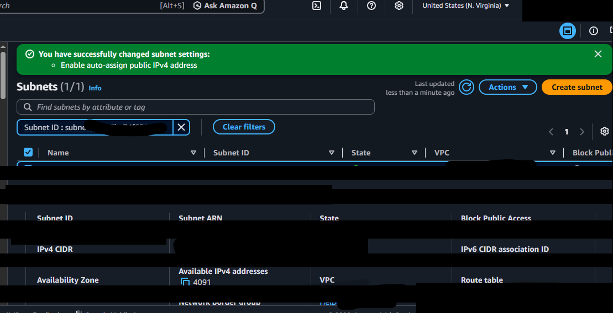
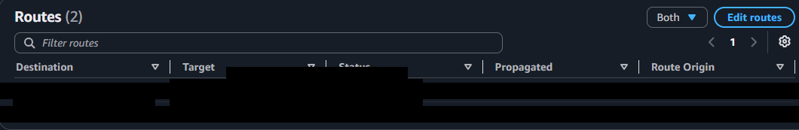

# AWS Networking

This public summary describes the networking skills demonstrated by the lab. Live addressing, cloud resource identifiers, internal names, administrative source addresses, and exact rule sets are intentionally omitted.

## Foundation

I created a virtual network with separate subnet allocations, an internet gateway, and routing. An availability-zone constraint required adjusting the compute deployment location.

The Windows systems and added Linux server use the existing compute network. The Linux addition did not require a new VPC or local virtual machine.

## Security-Group Direction

A useful lesson was identifying the destination resource and the initiating source separately:

- Directory traffic from Linux is permitted at the directory server's boundary.
- Browser traffic from the lab client is permitted at the web server's boundary.
- Administrative traffic is narrowly scoped rather than opened to all sources.
- A Linux host firewall enforces another layer of restrictions.
- The application backend stays on loopback behind its reverse proxy.

These are logical relationships, not a disclosure of the deployed access-control matrix.

## DNS and Service Discovery

Linux was configured to use directory-aware DNS persistently. Tests covered directory-service discovery, internal resolution, external resolution, and behavior after reboot.

A successful host lookup alone was not treated as proof that domain discovery or authentication would work.

## Limitations and Follow-Up

- Public routing does not mean unrestricted ingress; firewall controls still matter.
- Shared-network placement does not bypass host or cloud security controls.
- Positive application access was tested; negative tests from disallowed sources remain pending.
- An older broad lab connectivity allowance remains for later review.
- Any future changes to features, membership, or addressing require a fresh connectivity review.

## Historical Network Evidence

I kept these captures from the original build and covered the identifying details. They show the setup workflow, not a current network inventory.

See [Architecture](../documentation/architecture.md), [Linux Operations](../documentation/linux-operations.md), and [Evidence Notes](../documentation/evidence-notes.md) for the current build record and review scope.
