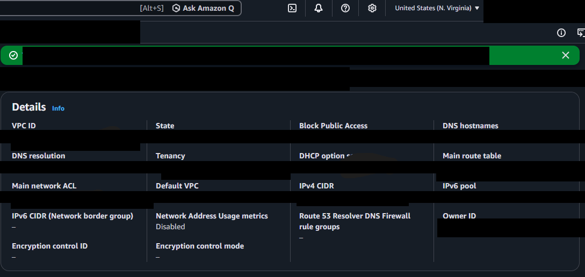

# AWS Networking

This section covers the AWS network I built for the lab before deploying the Windows machines.

## What I Built

- VPC: `[lab network resource]` — `[redacted address]`
- Public subnet: `[lab network resource]` — `[redacted address]`
- Internet Gateway: `[lab network resource]`
- Route table: `[lab network resource]`
- Default route: `[redacted address]` → Internet Gateway

## Evidence

These screenshots show the network configuration I completed in AWS. I removed or covered sensitive information before adding them to this public repository.

### VPC

The VPC is the main network boundary for the lab and uses the `[redacted address]` address space.

### Subnet

The public subnet uses `[redacted address]` and is associated with the lab VPC.

### Route Table

The route table contains the local VPC route and the default route to the Internet Gateway.

