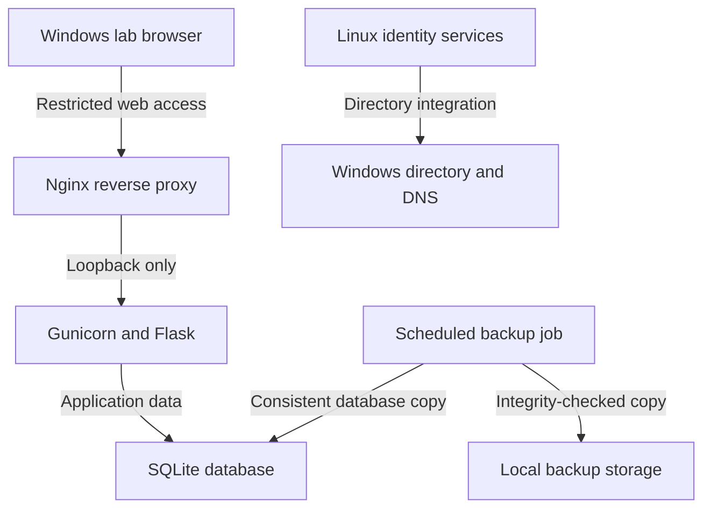

# Lab Architecture

Public portfolio summary, updated **October 16–17, 2026**. Component labels below are generic roles, not connection targets.

## Components

| Component | Purpose |
|---|---|
| AWS virtual network | Network boundary and routing for the lab |
| Windows directory server | Active Directory and DNS |
| Windows client | Domain-authentication, support, and browser tests |
| Ubuntu LTS server | Directory-integrated Linux and internal application hosting |
| Dedicated application identity | Runs the web backend without an interactive shell |
| Local backup job | Creates and validates SQLite copies |

Live network ranges, host/domain names, resource identifiers, account/group names, and exact access rules are intentionally excluded.

## Logical Service Flow

This is a conceptual diagram, not the deployed network map. The Linux identity integration and web-application access model are separate concerns.

## Security Design

- Cloud security groups and a Linux host firewall provide distinct network controls.
- Administrative access is restricted rather than openly exposed.
- The web backend binds to loopback and is reached through the proxy.
- Application code is owned by an administrative identity and is not writable by the application account.
- The application account has a dedicated writable data location.
- A protected environment file supplies runtime configuration; its contents are not published.
- A systemd unit runs the backend without root privileges and applies filesystem/process restrictions.
- Linux directory-account access and elevated commands are assigned through roles.

These controls reduce risk but do not establish production readiness or replace application-level authorization.

## Verified State

| Area | Evidence from the session |
|---|---|
| Directory membership | Discovery, join validation, machine trust, and identity resolution succeeded |
| Role policy | Intended allowed/denied account checks and elevated-command test passed |
| Host hardening | Key-based administration still worked after SSH/firewall changes |
| Application | Browser workflow and direct/proxied health checks succeeded |
| Persistence | A sample ticket remained after service restart |
| Backups | A manually triggered copy passed SQLite integrity validation |

## Pending Validation and Improvements

- Isolated database restoration and recovered-record comparison
- Complete instance stop/start recovery exercise
- Negative web-access testing from disallowed sources
- Application authentication/authorization and encrypted transport
- Backup retention, off-instance copies, and monitoring
- Review of an older broad connectivity rule

See [Linux Operations](linux-operations.md) and the [Operations Runbook](operations-runbook.md).
