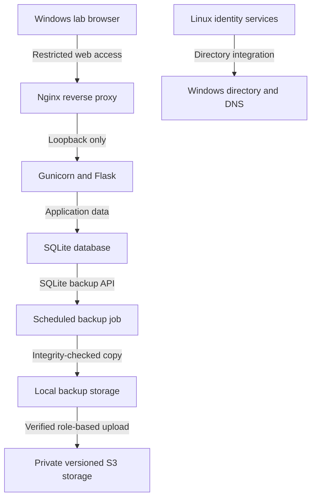

# Lab Architecture

Public portfolio summary, updated **October 17–18, 2026**. Component labels below are generic roles, not connection targets.

## Components

| Component | Purpose |
|---|---|
| AWS virtual network | Network boundary and routing for the lab |
| Windows directory server | Active Directory and DNS |
| Windows client | Domain-authentication, support, and browser tests |
| Ubuntu LTS server | Directory-integrated Linux and internal application hosting |
| Dedicated application identity | Runs the web backend without an interactive shell |
| Local backup job | Creates and validates SQLite copies |
| Private S3 storage | Versioned, encrypted database copies and a separate application/configuration snapshot |

Live network ranges, host/domain names, resource identifiers, account/group names, and exact access rules are intentionally excluded.

## Logical Service Flow

This is a conceptual diagram, not the deployed network map. The Linux identity integration and web-application access model are separate concerns.

## Security Design

- Cloud security groups and a Linux host firewall provide distinct network controls.
- Administrative access is restricted rather than openly exposed.
- The web backend binds to loopback and is reached through the proxy.
- Application code is owned by an administrative identity and is not writable by the application account.
- The application account has a dedicated writable data location.
- A protected environment file supplies runtime configuration; its contents are not published.
- A systemd unit runs the backend without root privileges and applies filesystem/process restrictions.
- Linux directory-account access and elevated commands are assigned through roles.
- An instance role supplies temporary credentials for private S3 backups; public access blocking, encryption, and versioning were checked.
- A separate recovery role is limited to two selected backup objects and their versions; IAM simulation allowed those reads and denied writes, deletes, and unrelated object reads.

These controls reduce risk but do not establish production readiness or replace application-level authorization.

## Verified State

| Area | Evidence from the session |
|---|---|
| Directory membership | Discovery, join validation, machine trust, and identity resolution succeeded |
| Role policy | Intended allowed/denied account checks and elevated-command test passed |
| Host hardening | Key-based administration still worked after SSH/firewall changes |
| Application | Browser workflow and direct/proxied health checks succeeded |
| Persistence | A sample ticket remained after service restart and the later instance restart cycle |
| Local backups | 14-copy policy installed; inspected jobs created verified copies and exited successfully |
| Private cloud backups | Encryption, versioning, SHA-256 checks, readback, database restoration, and anonymous-access denial passed |
| Cloud retention | Lifecycle configuration inspected; current latest recovery copy has no date-based expiration |
| Isolated restore | Integrity passed; one ticket in both copies; no missing or extra rows |
| Application/configuration recovery | 14 application files preserved; all 36 archived files restored and verified |
| Recovered application | 12 recovery checks and four original regression tests passed using recovered code and isolated data |
| Replacement-host preparation | Exact image, network, and recovery policy checks passed; launch permission dry run passed; not launched |
| Restart readiness | Identity/proxy/application services, directory trust, time, and direct/proxied database health passed; no failed Linux units reported |

## Pending Validation and Improvements

- Fresh dependency installation and a complete application/proxy rebuild on a replacement host
- Negative web-access testing from disallowed sources
- Planned Windows certificates, company intranet, and domain web authentication/authorization
- A later unattended backup with the repaired cloud upload hook, and service/backup-failure monitoring
- Review of an older broad connectivity rule

See [Linux Operations](linux-operations.md), the [Backup and Recovery Record](backup-and-recovery.md), the [Operations Runbook](operations-runbook.md), and the [Roadmap](roadmap.md). The current diagram describes the implemented service and backup flow; the repaired cloud hook is verified by manual complete-job runs. The planned replacement host, certificate authority, and authentication gateway are not deployed components in this diagram.
