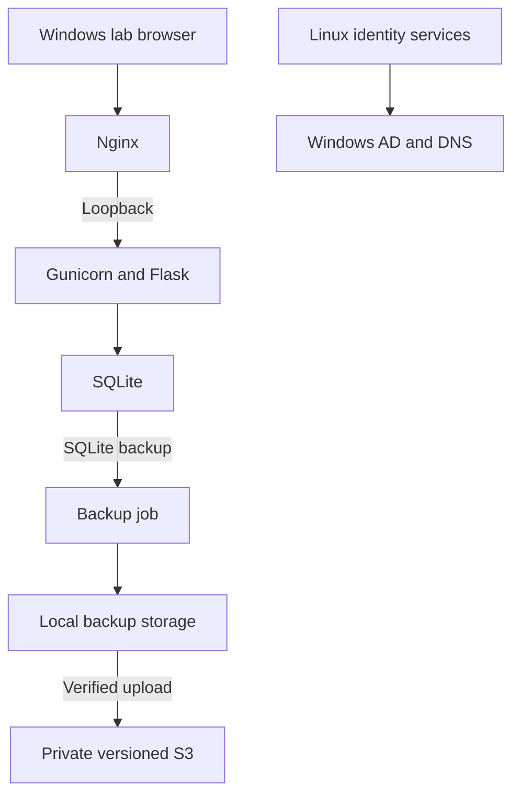

# Lab Architecture

Recorded checkpoint: **October 18, 2026**. I use role labels in place of live connection details.

The Windows server supplies directory services and DNS. The Ubuntu server hosts the portal and uses SSSD for OS authentication. The portal's web login has not been implemented.

I configured a dedicated application account, administratively owned code, a separate writable data location, and a protected environment file. Gunicorn listens on loopback behind Nginx. Cloud security groups and the host firewall provide separate access controls.

The backup job uses temporary instance-role credentials for S3. A separate recovery role passed a read-access simulation for selected backup versions; it has not been tested from a replacement host.

See [Linux configuration](linux-operations.md), [recovery results](backup-and-recovery.md), and [planned components](roadmap.md).
