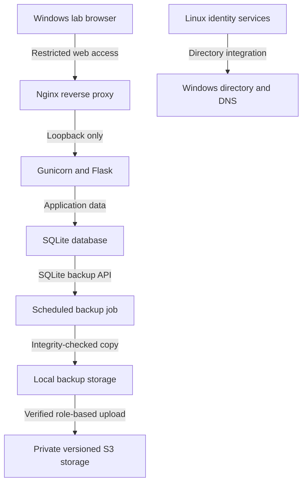

# Lab Architecture

Verified checkpoint: **October 18, 2026**. Labels describe component roles; live connection details are omitted.

## Components

| Component | Purpose |
|---|---|
| AWS virtual network | Routing and cloud security boundaries |
| Windows directory server | Active Directory and DNS |
| Windows client | Authentication, support, and portal browser tests |
| Ubuntu 24.04 LTS server | Directory integration and application hosting |
| Dedicated application identity | Runs the backend without an interactive shell |
| Local backup job | Creates, validates, and retains SQLite copies |
| Private S3 storage | Versioned database backups and a separate application/configuration snapshot |

## Service Flow

The diagram shows service relationships, not a network inventory. The cloud upload hook passed complete manual jobs after repair; a later unattended run is still pending.

## Implemented Controls

- Cloud security groups and the Linux host firewall restrict access independently.
- The backend listens on loopback behind Nginx.
- A non-login service account can write application data but cannot replace administratively owned code.
- A protected environment file supplies runtime configuration.
- The systemd service runs without root and restricts filesystem writes, temporary space, and privileges.
- Directory roles govern Linux account access and sudo.
- Temporary instance-role credentials support encrypted, versioned private S3 backups.

A separate recovery role passed simulation for two selected backup objects and versions, with writes, deletes, and unrelated reads denied. The recovery host has not been launched or exercised that role.

## Verification and Limits

Directory trust, identity resolution, role checks, key-based administration, portal workflows, health checks, and restart persistence passed during the sessions. See [Linux operations](linux-operations.md) for those checks and [backup and recovery](backup-and-recovery.md) for the restore evidence.

The portal still needs application authentication/authorization and HTTPS. Negative web-access testing and review of an older broad connectivity rule remain pending. The replacement host, certificate authority, and authentication gateway are planned components in the [roadmap](roadmap.md).
