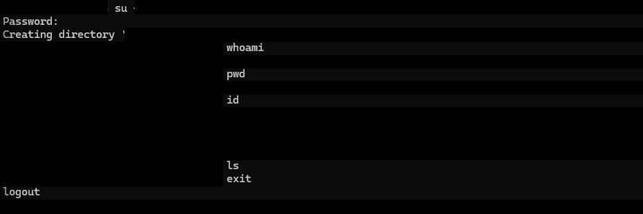
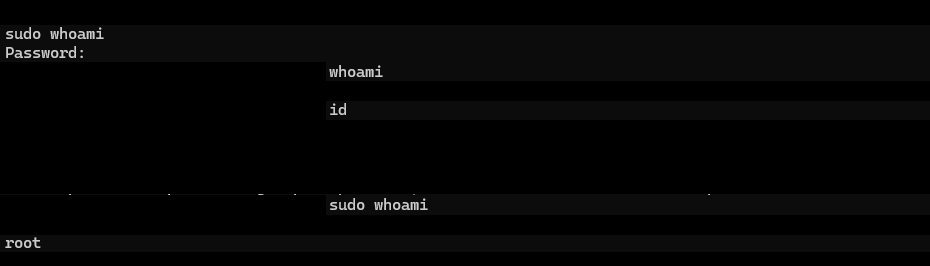
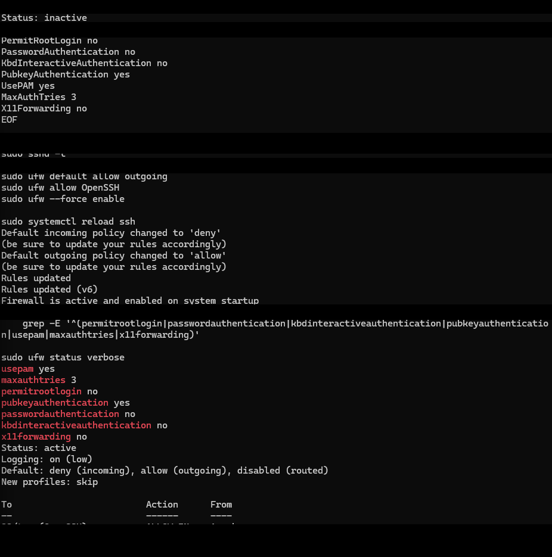
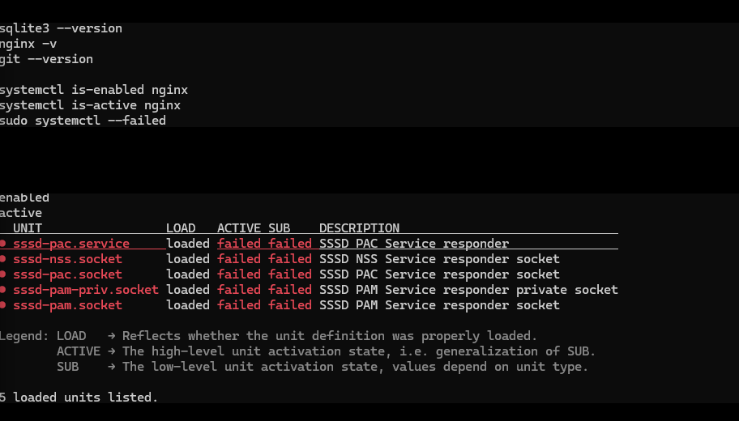
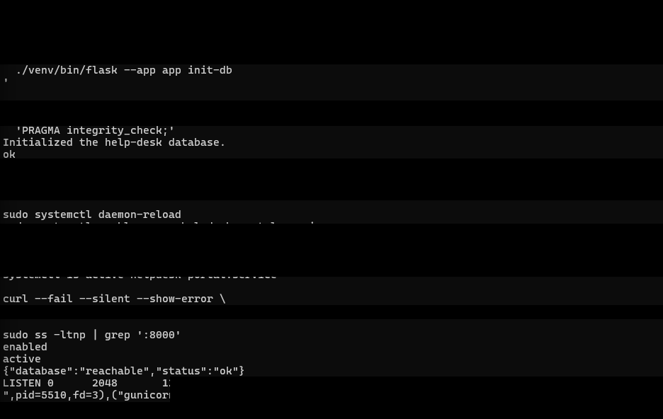
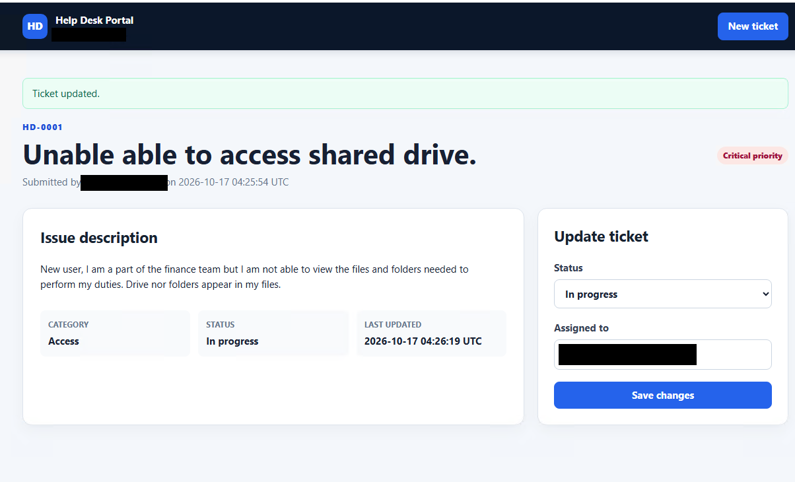

# Linux IT Operations Extension

Build session: **October 16–17, 2026**. Recovery follow-up: **October 17–18, 2026**. This public record explains methods and verified outcomes without publishing live infrastructure or identity details.

## Phase 0 — Brief Foundation Check

Before adding Linux, I revalidated existing Windows remote access, shared-resource permissions, and role membership. Temporary elevated access was removed. A live directory query also exposed a mismatch between the client's actual organizational-unit placement and the older documentation.

Only these meaningful outcomes are carried forward here; the Windows setup is not repeated.

## Linux Infrastructure

I kept the Linux build on AWS to use the existing lab environment and practice cloud connectivity. The deployment used Ubuntu LTS, encrypted storage, restricted administration, and hardened instance metadata access.

I then:

- Updated the operating system and checked time synchronization.
- Set persistent host identity and directory-aware DNS configuration.
- Verified directory-service discovery and external name resolution.
- Rechecked DNS behavior after reboot.

Live addressing, connection targets, launch/resource identifiers, key names, and detailed network rules are not included in this public write-up.

## Active Directory Integration

A dedicated organizational unit was created for the Linux system and protected from accidental deletion. I joined the server using realmd/adcli with SSSD, entering the privileged credential interactively rather than storing it in a script.

| Validation | Result |
|---|---|
| Domain discovery | Directory discovered |
| Membership listing | Configured as a Kerberos member using SSSD |
| Identity service | Active |
| Machine trust | Join validation passed |
| Directory computer object | Present in the intended location |
| Name resolution | Server registration resolved correctly |
| Identity/group lookup | Fictional lab identities and roles resolved |

I restricted domain-account access to the designated administration role, enabled automatic home-directory creation, and verified an interactive domain-account session.

A sudoers rule delegated elevated commands through the same role group. Its syntax was checked before testing, and the elevated identity check succeeded.

The local key-based administration path remained available. Direct SSH login using a directory identity was not part of the verified workflow, and OS membership did not add web-application single sign-on.

This captures the session and identity-check commands. I covered the account, group, and home-directory output rather than publishing those identifiers.

## Host Hardening

I disabled root/password-based SSH access, retained public-key access, reduced authentication attempts, and disabled unused forwarding. Configuration syntax was checked before reload, and a second key-based connection succeeded.

The host firewall was enabled with restrictive incoming defaults and explicit lab allowances. Cloud and host firewall rules were treated as separate layers.

The image includes the initial firewall state and the final enabled state after configuration.

### SSSD responder repair

Installing the application prerequisites revealed failed SSSD responder services/sockets even though the main identity service and machine trust were working.

The host had overlapping explicit responder configuration and socket activation. I backed up the configuration, removed the conflict for this installation, preserved restrictive ownership/permissions, validated the configuration, and restarted the service.

The follow-up checks showed no failed units, working directory lookups, and a successful trust check. Clearing failed-state indicators alone would not have proved the repair.

This was a host-specific correction, not a universal recommendation to remove responder settings from every SSSD deployment.

This is the failure I investigated. The successful follow-up checks were confirmed during the session, but their screenshot was not in the supplied folder. I have reserved `pictures/sssd-fix.png` for a later capture.

## Internal Help Desk Portal

I deployed an AI-assisted starter application to connect my Linux administration practice with Python and database coursework.

### Stack and capabilities

- Flask application and Flask-WTF form protection
- SQLite ticket storage
- Gunicorn backend behind Nginx
- Ticket creation, details, status/assignee updates, and filters
- Parameterized SQL and server-side input validation
- Database constraints, template escaping, and CSRF-protected POST requests
- A database-reachability health endpoint

Before deployment, the starter passed four tests covering health, a ticket lifecycle, invalid input, and a missing-ticket response. A separate Gunicorn smoke test checked the dashboard and health response. These were starter-bundle checks, not a complete security assessment or an existing CI pipeline.

### Service design

| Control | Implemented approach |
|---|---|
| Process identity | Dedicated system account with a non-login shell |
| Application code | Administratively owned; not writable by the app account |
| Database | Dedicated writable application-data location |
| Configuration | Random server-generated secret in a protected environment file |
| Backend listener | Loopback only |
| Process management | Enabled systemd service |
| Service restrictions | Non-root execution, restricted filesystem writes, private temporary space, and privilege restrictions |
| Front end | Reverse proxy with request limits and defensive response headers |

No live secret, private key, database, access rule export, or executable connection command is included here.

### Deployment verification

I transferred the starter bundle from Windows, checked its checksum on Linux, installed the code and dependencies, and initialized SQLite using the application identity. Database integrity validation succeeded.

A practical correction was recognizing the shell boundary: Windows PowerShell syntax does not work inside an SSH Bash session. I reran the upload from the correct shell.

The application service was enabled and verified, and the backend listener was checked before configuring the proxy.

I tested proxy configuration before reloading it, applied restricted lab access, and opened the portal from the Windows client. I created and updated a fictional ticket to check the workflow.

### Restart and gateway-error investigation

A request immediately following a combined proxy/backend restart returned a gateway error, even though both processes reported active. Subsequent direct-backend and proxied health requests succeeded. This is consistent with a brief startup-readiness race rather than a persistent proxy problem; no configuration change was needed.

A database query also confirmed that the sample ticket survived the restart. I recorded the failure and successful follow-up instead of treating process status alone as proof of readiness.

### Scope limitations

The portal remains a restricted lab prototype with fictional data. Application login, role-based ticket authorization, and encrypted web transport are not yet implemented. Directory membership on the host does not supply those application features.

## Scheduled SQLite Backups

The backup job uses SQLite's backup mechanism instead of a plain copy of an active database. It creates timestamped copies and checks structural integrity before reporting success.

| Item | Verified state |
|---|---|
| Backup script | Administratively owned with restrictive permissions |
| Backup service | Manual activation succeeded |
| Timer | Enabled, active, and listed with a next run |
| Produced copies | Present and integrity-checked; updated job retains the newest 14 completed copies |
| Schedule handling | UTC-based with a randomized delay and persistent catch-up behavior |
| Restoration | Isolated copy passed integrity and record comparisons; live database unchanged |

Exact backup paths and timing are omitted from this public record.

I updated the local job to use Python's SQLite online backup API, temporary staging, atomic publication, and an exclusive lock. It validates all copies selected for retention before pruning older recognized backups. The first inspected retention run found three copies, kept three, and removed none; later runs accumulated more copies while still below the retention threshold. Local fixtures exercised expiration and failure cases without deleting live backups.

### Private S3 backup and retention

I installed the AWS CLI after verifying its signature and attached a backup role to the application host. Uploads use temporary instance-role credentials. The private bucket has public access blocking, server-side encryption, and versioning enabled.

The uploader verifies a dated database snapshot and a separate latest recovery object using size, SHA-256, encryption, and version metadata. Downloading a copy produced an exact byte match; the restored database passed integrity and ticket-count checks. Anonymous object access was denied.

Cloud lifecycle rules now cover daily snapshots, old latest-recovery versions, and disposable validation copies. The current latest recovery object has no date-based expiration. I preserved unrelated rules and rechecked public access blocking and versioning after the change.

The first observed timer activation created only a local copy. Inspecting the loaded service showed the S3 upload hook was missing. I restored the drop-in, confirmed it was loaded, and verified three complete manual service runs, including fresh status records. A later unattended run with the repaired hook loaded remains pending.

Recovery boundaries:

- Local copies remain on the application host; verified S3 copies provide separate storage.
- A stopped instance cannot execute backups; a persistent timer can catch up after startup.
- UTC schedules do not remain at the same local clock time across daylight-saving changes.
- The 14-copy local retention policy was tested with fixtures; the supplied live runs did not reach the expiration threshold.
- Database copies do not include every host configuration item or the application secret.
- Integrity checking alone does not prove useful records can be restored; the separate restore below supplies that additional evidence.

## Recovery Follow-Up

I restored the existing backup into a separate temporary SQLite file and opened the source backup read-only for comparison. The restored file passed integrity checking. Both copies held one ticket, and full-row comparisons found zero missing rows and zero extra rows. I did not overwrite the live database.

After bringing all three instances back online, I checked the identity service, proxy, application, directory trust, time synchronization, both database-health paths, and failed-unit list. The checks passed, and the existing ticket remained visible from the Windows client. These results come from the session output and browser confirmation; new screenshots have not been added.

### Application/configuration recovery

I inventoried the deployed sources, active service/proxy configuration, environment variable names, and Python dependencies. The later reviewed package preserved 14 application files and 36 archived files in total. It excluded the live secret, database, and machine credentials. Private S3 upload/download checks passed, and every restored archived file matched its recorded hash.

An initial isolated application drill used the deployed code. I then repeated the meaningful application checks using the actual recovered sources, templates, and schema. The dependency inventory matched the existing Python environment. With a fresh test secret, isolated data, restricted execution, and recovered code held read-only, 12 recovery checks and four original regression tests passed. The live database's logical contents stayed unchanged. A subsequent live check confirmed active proxy/application services and successful database health.

### Replacement-host preparation

I prepared a separate recovery role restricted to two selected backup objects and their versions. IAM simulation allowed those reads and denied writes, deletes, and unrelated object reads. The preparation checked the exact Ubuntu image identity, SSH key name, subnet, route, and ingress rules, then passed an EC2 launch permission dry run.

The image check initially rejected additional non-EBS mappings. I corrected it to locate the expected root EBS mapping by device name and permit recognized non-EBS entries while rejecting unexpected extra EBS disks. The revised preparation passed against the live image. The proposed recovery host has encrypted storage, IMDSv2, and Standard CPU credits; it has not been launched.

These drills prove the listed backup, file-restoration, and recovered-source behaviors. They do not yet prove a fresh host, fresh dependencies, or a complete Gunicorn/Nginx/browser rebuild. The configuration package is a manual snapshot, separate from daily database backups. See the [detailed recovery record](backup-and-recovery.md).

## Next Milestone

Launch the separate recovery host and rebuild from the selected backup versions with fresh dependencies and a new application secret. Keep its backup timer/uploader disabled, test the complete web workflow, and confirm the original service and data stay unchanged. Then follow the planned certificate, intranet, and domain sign-in extension before automating the expanded configuration.

See the [Roadmap](roadmap.md), [Operations Runbook](operations-runbook.md), and [Evidence Notes](evidence-notes.md).
